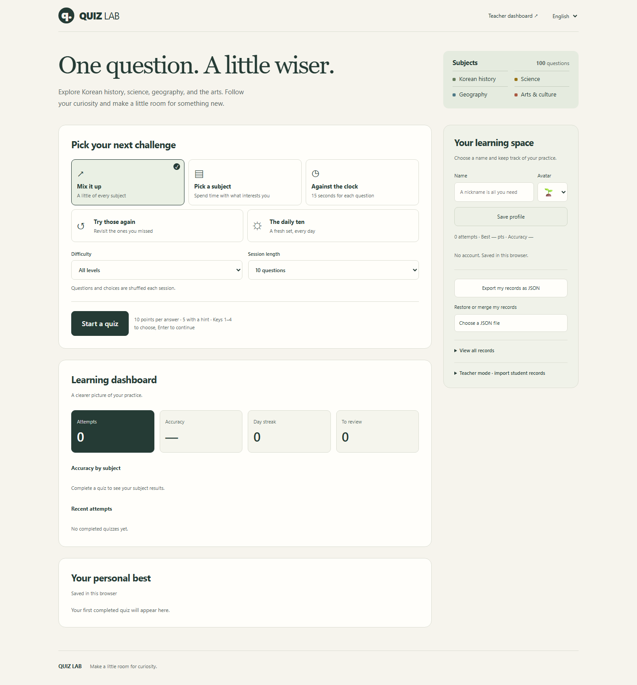

# Study Quiz Go

[한국어](README.md) | **English**

This is the JavaScript-to-Go port of [QUIZ LAB (Study-Quiz)](https://github.com/leekmny/Study-Quiz). Go runs question selection, scoring, timeouts, saved-record statistics, and teacher report aggregation and CSV generation. The browser uses the original HTML, CSS, and JavaScript interface with the Go engine compiled to WebAssembly. The native Go CLI exposes the same operations for comparison and testing.

The port started from [Study-Quiz commit `ce88328`](https://github.com/leekmny/Study-Quiz/commit/ce88328beff36b2a5f3273051397a22029aa8995). The original port's [RECHECK run](verification/recheck-summary.json) matched **18/18** gameplay, saved-record, and teacher-report scenarios on Linux amd64. See the [Go CLI and reproduction guide](docs/go-port-cli.md) for the commands and comparison scope.

## Run the Go browser build

Use Node.js 22 or later and Go 1.24 or later. If Go is unavailable, the build uses Docker with Linux containers.

```sh
npm ci
npm run build:go
```

Open `dist-go/index.html` in a browser. It works offline. To move records from QUIZ LAB opened at a different address or file path, export them as JSON and import them in this build.

Run the native Go CLI with a sample request:

```sh
go run ./cmd/studyquiz verification/gameplay/speed.json
```



## Features

- 100 questions across Korean history, science, geography, and arts and culture
- Korean and English interfaces, questions, hints, explanations, and reports
- Shuffled questions and choices, difficulty filters, and 10/20/full sessions
- Mixed practice, subject practice, 15-second speed rounds, a daily ten, and mistake review
- Hints, answer explanations, and question references
- Personal stats, accuracy by subject, study streaks, and recent attempts
- JSON backup and restore, plus record imports for teacher reports with HTML and CSV downloads
- Responsive layout and keyboard controls

Correct answers earn 10 points, or 5 after a hint. Use keys 1–4 to answer and Enter to continue. Daily questions stay the same for the device's local date. A later correct answer clears a question from the review list.

## Data and questions

Profiles and the latest 100 attempts stay in the current browser's storage. There is no server upload or analytics tracking. Export JSON to move your history between browsers. Exported records and teacher reports contain the names and scores you enter; keep them out of public repositories.

[Question sources](docs/question-sources.md) document the references for the 48 added questions and the scope of the review of existing questions.

## Development

```sh
go test ./...
go vet ./...
npx playwright install chromium
npm run test:go:browser
npm test
npm run check
```

Browser tests use installed Edge on Windows and Playwright Chromium elsewhere. Set `PLAYWRIGHT_CHANNEL` to select another channel.

Deploy `dist-go/` to a static host. The build includes app files and an empty teacher report. Use teacher grades as a study aid. They are relative to the imported group and do not adjust for different modes or difficulty levels.

Use `npm start` for the JavaScript reference UI at `http://localhost:4173`, and `npm run test:browser` for its browser tests. `npm run build` creates the JavaScript reference build in `dist/`.

[Design notes](docs/design-notes.md) list the projects that informed feature choices.
