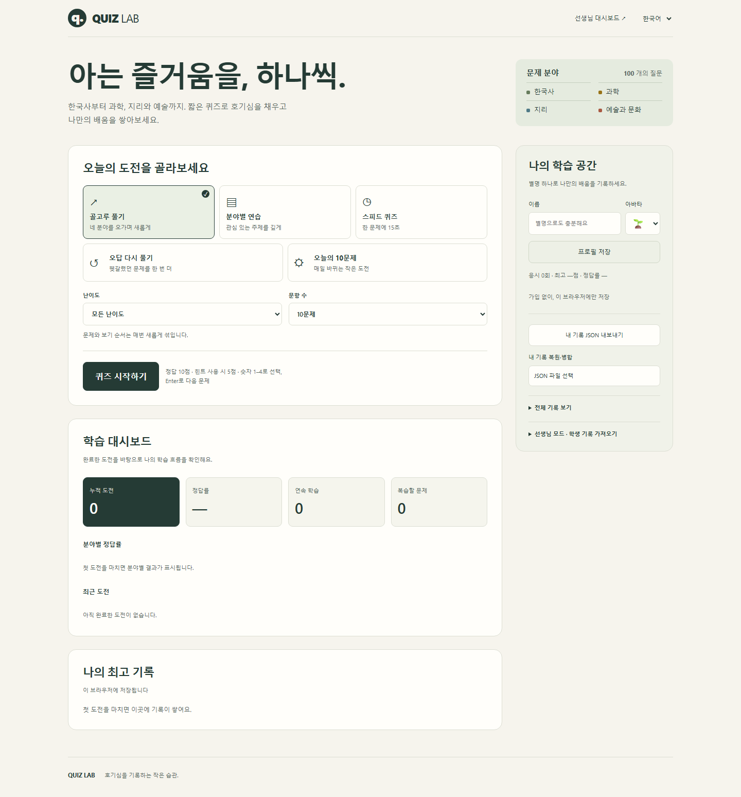

# Study Quiz Go

[한국어](README.ko.md) | [English](README.md)

[QUIZ LAB(Study-Quiz)](https://github.com/leekmny/Study-Quiz)의 JavaScript 로직을 Go로 옮긴 포팅판입니다. 문제 선택, 채점, 시간 초과, 학습 기록 통계와 교사 보고서 집계·CSV 생성을 Go로 처리합니다. 브라우저에서는 기존 HTML·CSS·JavaScript 화면이 Go WebAssembly 엔진을 사용하며, 네이티브 Go CLI에서도 같은 기능을 실행할 수 있습니다.

[Study-Quiz 커밋 `ce88328`](https://github.com/leekmny/Study-Quiz/commit/ce88328beff36b2a5f3273051397a22029aa8995)을 기준으로 포팅했습니다. 최초 포팅판의 [RECHECK 결과](verification/recheck-summary.json)에서는 Linux amd64에서 퀴즈 진행·학습 기록·교사 보고서 시나리오 **18개 중 18개**가 일치했습니다. 실행 방법과 비교 범위는 [Go CLI 및 검증 재현 가이드](docs/go-port-cli.md)에 있습니다.

## Go 브라우저 빌드 실행

Node.js 22 이상과 Go 1.24 이상이 필요합니다. Go가 설치되어 있지 않으면 빌드가 Docker의 Linux 컨테이너를 사용합니다.

```sh
npm ci
npm run build:go
```

`dist-go/index.html`을 브라우저에서 열면 오프라인으로 실행됩니다.
원본과 포팅판을 다른 주소나 파일 경로에서 열 경우에는 원본의 기록 JSON을
내보낸 뒤 포팅판에서 가져오세요.

예제 입력으로 네이티브 Go CLI를 실행할 수 있습니다.

```sh
go run ./cmd/studyquiz verification/gameplay/speed.json
```



## 기능

- 한국사·과학·지리·예술과 문화 100문항, 한국어·영어 전환
- 문제와 보기 무작위 출제, 난이도와 10·20·전체 문항 선택
- 전체·분야별·15초 스피드·오늘의 10문제·오답 복습
- 힌트, 정답 해설, 참고 출처와 키보드 조작
- 개인 대시보드, 분야별 정답률, 연속 학습일과 최근 기록
- 기록 JSON 백업·복원, 교사용 보고서 가져오기와 HTML·CSV 저장
- 모바일 화면과 키보드 접근성 지원

정답은 10점, 힌트를 사용한 정답은 5점입니다. 오늘의 도전은 기기의 날짜를 기준으로 같은 날 같은 10문제를 출제합니다. 오답 복습에서는 나중에 맞힌 문제를 제외합니다.

## 데이터와 문항

프로필과 최근 100회 기록은 현재 브라우저의 저장소에 보관됩니다. 서버 전송이나 분석 추적은 없습니다. 다른 브라우저로 옮길 때는 JSON을 내보내세요. 내보낸 파일과 교사 보고서에는 입력한 이름·성적이 포함되므로 공개 저장소에 넣지 마세요.

추가한 48문항의 참고 자료와 기존 문항의 검토 범위는 [문항 출처](docs/question-sources.md)에 기록했습니다.

## 개발과 배포

```sh
go test ./...
go vet ./...
npx playwright install chromium
npm run test:go:browser
npm test
npm run check
```

Windows의 브라우저 검사는 설치된 Edge를 사용합니다. 다른 환경에서는 Playwright Chromium을 사용하며, `PLAYWRIGHT_CHANNEL`로 채널을 지정할 수 있습니다.

`dist-go/`를 정적 호스팅에 올리면 됩니다. 빌드에는 앱 파일과 빈 교사 보고서가 포함됩니다. 교사 보고서의 상대 등급은 모드·난이도 차이를 보정하지 않으므로 학습 참고용으로 사용하세요.

JavaScript 비교용 화면은 `npm start`를 실행하고 `http://localhost:4173`에서 열 수 있습니다. `npm run test:browser`는 이 화면을 검사하며, `npm run build`는 JavaScript 비교용 빌드를 `dist/`에 생성합니다.

참고한 프로젝트는 [design notes](docs/design-notes.md)에 정리했습니다.
